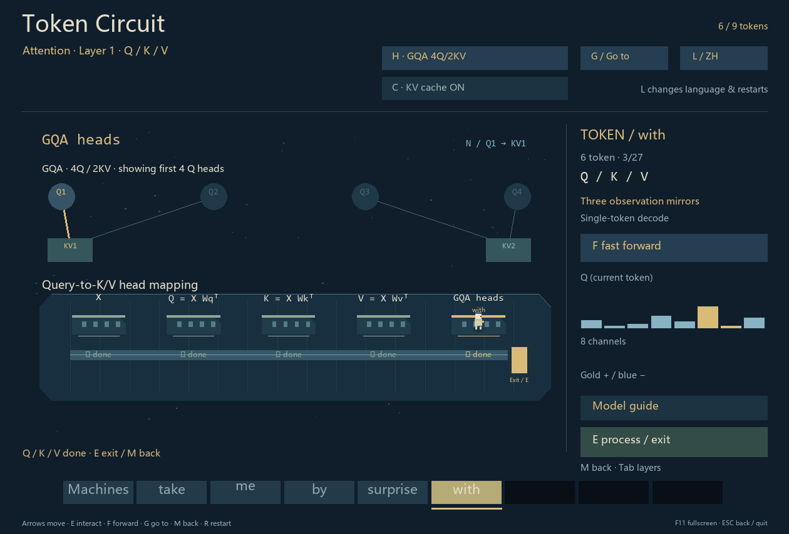

# Token Circuit · Token 回路

[中文](README.md) | [English](README.en.md)

**Become a token. Walk inside a neural network.** An offline pixel exploration game where matrix chambers, rotary rings and expert junctions form a Transformer, and a sentence lights up one token at a time.

Python 3.10+ · No AI API · No third-party runtime dependencies · MIT


## Download and play

**Windows:** [Download the source ZIP](https://github.com/TiancanXia/token-circuit/archive/refs/heads/main.zip), extract it and double-click `start.cmd`. Install [Python 3.10 or newer](https://www.python.org/downloads/) with Tcl/Tk first. Alternatively, run in the extracted folder:

```powershell
python game.py
```

**macOS / Linux:** Use Python with Tkinter in a graphical desktop session:

```sh
python3 game.py
```

Check Tk with `python3 -m tkinter`; some Linux distributions package Python Tk support separately. Windows has been verified; macOS / Linux have not been playtested.

This is a local desktop game; there is no browser version or model-weight download. Move toward Embedding and press **E**, then explore the rooms. Press **F** to see one complete forward pass immediately. Press **L** to switch the initial Chinese interface to English.


## Controls

| Action | Key |
| --- | --- |
| Move / enter or process | Arrow keys or WASD / E or Enter |
| Return one map level | M; Esc leaves fullscreen first, then returns/exits |
| Complete the current forward pass quickly | F |
| Jump to a specific block and stage | G, arrows to select, Enter to confirm |
| Switch MHA / GQA; toggle KV cache | H / C; both restart the journey |
| Inspect another Q head / reached layer | N / Tab |
| Switch language / restart / fullscreen | L / R / F11 |

Explanation buttons open detailed documents and pause the game. See the [player guide](docs/player-guide.en.md) for the complete walkthrough.

## What you can explore

- Three map levels: Transformer world, module rooms and Attention submodule rooms.
- Q/K/V projections, RoPE, head attention, Concat and output projection; MHA versus GQA.
- RMSNorm, residuals, Dense FFN, MoE and next-token probabilities.
- Actual KV-cache computation, manual exploration and a fast forward-pass flight.
- Chinese and English interface and explanations; token dissolution and reassembly.



## Scope

This is an **explorable miniature model**, not a trained chatbot. It performs real matrix computations with fixed, untrained parameters. The default two-block pre-norm causal decoder includes Dense FFN and MoE, RMSNorm and RoPE; it is not an exact GPT-2 / GPT-3 implementation.

The hidden width is 8, with 4Q/4KV in MHA or 4Q/2KV in GQA. Vocabulary sizes are 16 in Chinese and 12 in English. The journey reveals a prescribed sentence: **its text is independent of the probability chart**. Top 7 shows the seven highest full-vocabulary probabilities and labels the remaining mass; it does not select the journey's next character. Chinese uses character tokens; English uses words and punctuation, rather than a production tokenizer.

Only Transformer is currently playable. DiT and embodied-intelligence networks are possible future directions, not implemented features. See the [model notes](docs/model-audit.md) for computational details.

## Players and developers

- Players: [English guide](docs/player-guide.en.md) · [中文指南](docs/player-guide.md)
- Developers: [Development and contributing](CONTRIBUTING.md) · [Architecture and extension guide](docs/architecture.md) · [Documentation index](docs/README.md)
- [Changelog](CHANGELOG.md) · [Report an issue](https://github.com/TiancanXia/token-circuit/issues)

## License and attribution

Project code and original visual assets are released under the [MIT license](LICENSE). Journey text quotes a short passage from Alan Turing's *Computing Machinery and Intelligence* (1950); Chinese text is a translation. [Original publication](https://doi.org/10.1093/mind/LIX.236.433). Quoted material and system fonts retain their respective rights; MIT does not relicense third-party material.
