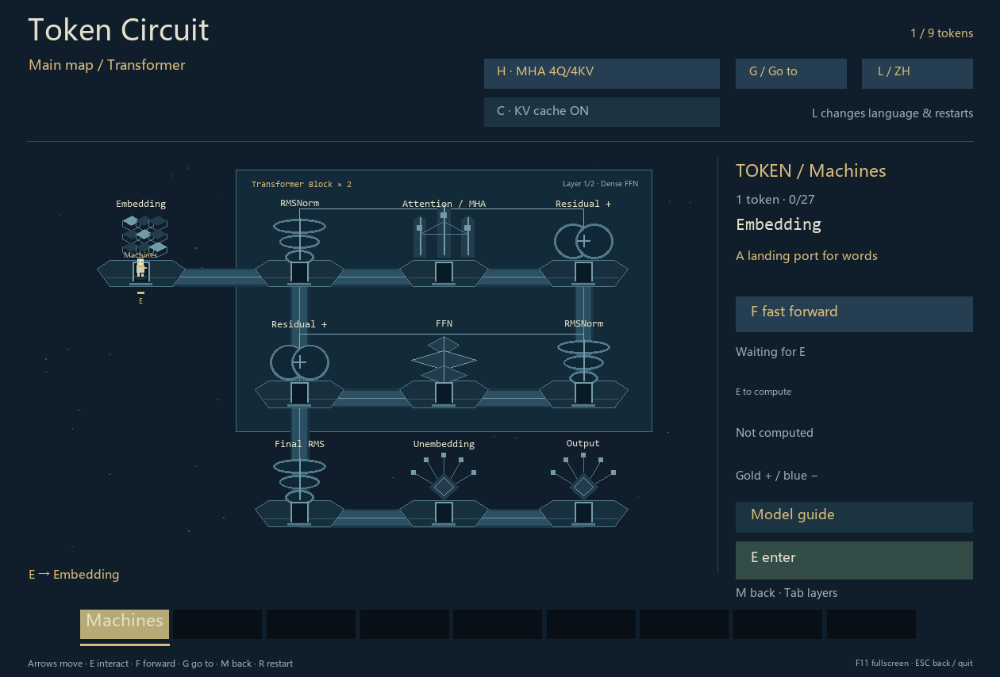
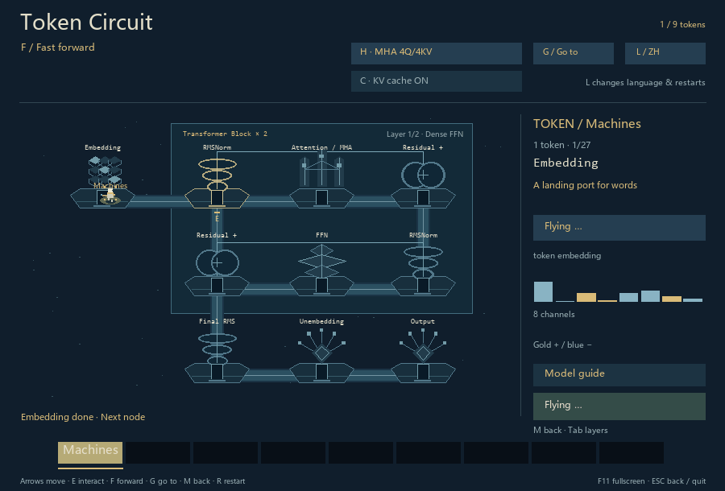
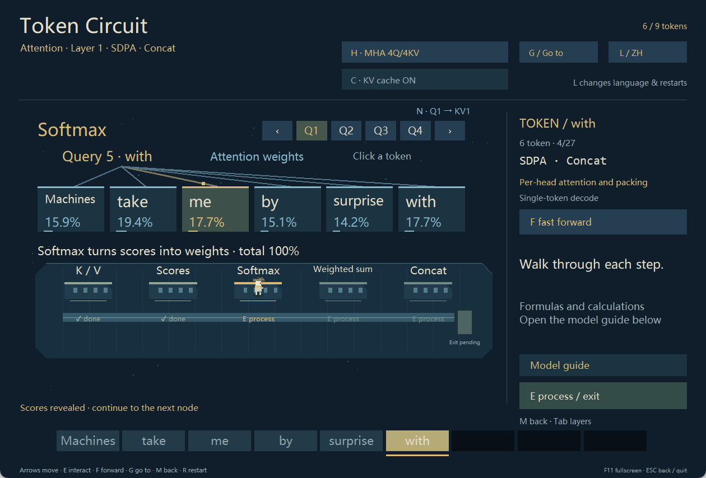

# Token Circuit

[English](README.md) | [简体中文](README.zh-CN.md)

A pixel game where you guide a token through a Transformer and explore its modules.



## Play

[Download ZIP](https://github.com/TiancanXia/token-circuit/archive/refs/heads/main.zip) and extract it. Install [Python 3.10+](https://www.python.org/downloads/) with Tkinter.

On Windows, double-click `start.cmd` or run:

```sh
python game.py
```

On macOS / Linux, use `python3 game.py` in a graphical desktop. These platforms have not been playtested. If Tk is missing, check with `python3 -m tkinter` and install your platform's Python Tk support.

Move toward Embedding and press **E**. Press **F** to complete one forward pass quickly, or **L** to switch to English.



## Controls

| Action | Key |
| --- | --- |
| Move | Arrows / WASD |
| Enter or process | E / Enter |
| Return one map level | M |
| Fast forward pass | F |
| Select a block and stage | G, arrows, Enter |
| Switch MHA / GQA | H |
| Toggle KV cache | C |
| Inspect Q head / reached layer | N / Tab |
| Language / restart / fullscreen | L / R / F11 |

H, C and L restart the journey. Esc closes an open document or picker, leaves fullscreen, returns a map level, or exits on the world map, according to the current view.

Click a module's explanation button for details. Reading pauses the game.

In Attention, click Q1–Q4 or press N to inspect another head in any room. Click tokens to highlight their scores and weights. Open the model guide for formulas and examples.



## About the model

The game computes a small Transformer with fixed, untrained weights. The sentence is independent of the displayed probabilities. See [model notes](docs/model-audit.md) for details.

## Documentation

- Players: [Player guide](docs/player-guide.md) — first journey, controls and help.
- Developers: [Contributing](CONTRIBUTING.md) · [Code structure](docs/architecture.md) · [Model computation](docs/model-audit.md)
- [Changelog](CHANGELOG.md) · [Report an issue](https://github.com/TiancanXia/token-circuit/issues)

## License

Code and original visual assets: [MIT](LICENSE). The sentence quotes Alan Turing's *Computing Machinery and Intelligence* (1950), with a Chinese translation: [source](https://doi.org/10.1093/mind/LIX.236.433). Quoted material and system fonts retain their respective rights.
