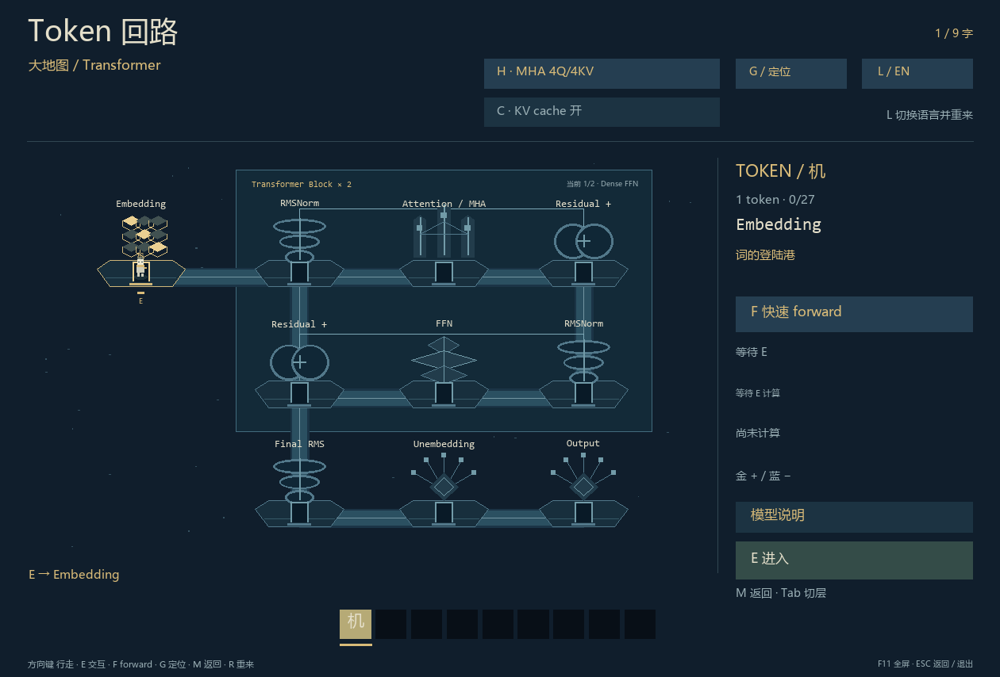
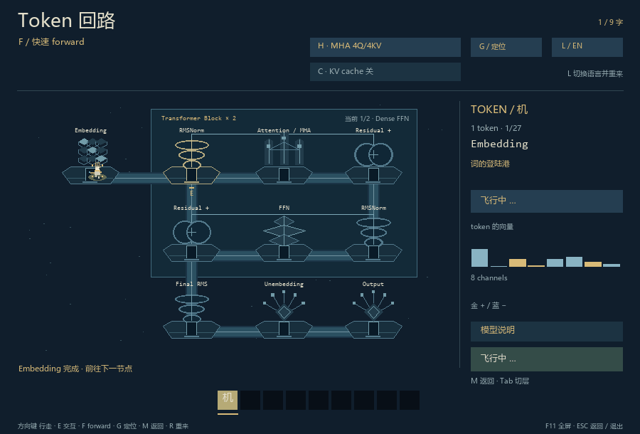
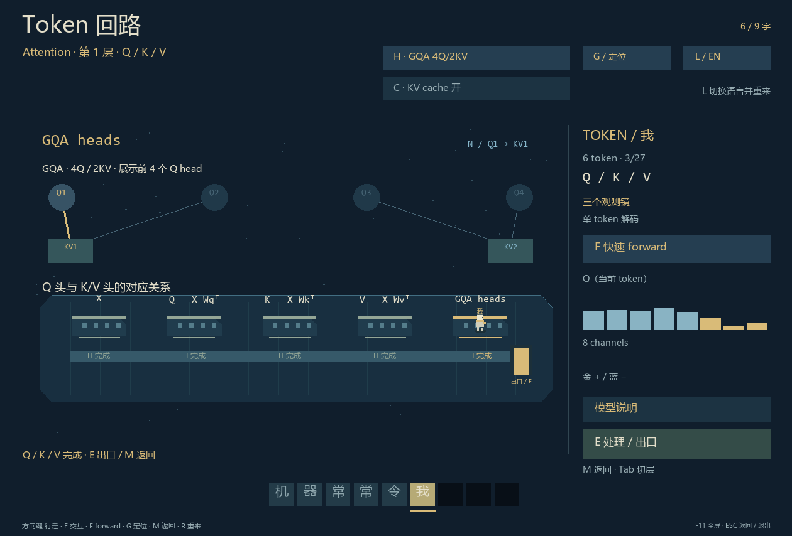

# Token 回路 · Token Circuit

[中文](README.md) | [English](README.en.md)

**变成一个 token，走进神经网络。** 一个离线的像素探索小游戏：穿过 Transformer 的矩阵舱、旋转环和专家分流装置，看一句话逐步亮起。

Python 3.10+ · 无 AI API · 无第三方运行依赖 · MIT



## 下载与试玩

**Windows：** [下载源码 ZIP](https://github.com/TiancanXia/token-circuit/archive/refs/heads/main.zip)，解压后双击 `start.cmd`。先安装带 Tcl/Tk 的 [Python 3.10 或更新版本](https://www.python.org/downloads/)。也可以在解压目录运行：

```powershell
python game.py
```

**macOS / Linux：** 在图形桌面中使用带 Tkinter 的 Python：

```sh
python3 game.py
```

`python3 -m tkinter` 可检查 Tk 是否可用；部分 Linux 发行版需要单独安装 Python 的 Tk 支持。Windows 已验证，macOS / Linux 尚未实际试玩验证。

这是本地桌面游戏，没有浏览器试玩入口，也不需要下载模型权重。第一次游玩：方向键靠近 Embedding → **E** 进入 → 沿房间逐步前进；想先看完整旅程，按 **F**。



## 怎么玩

| 操作 | 按键 |
| --- | --- |
| 移动 / 进入或处理 | 方向键或 WASD / E 或 Enter |
| 返回上一层地图 | M；Esc 先退出全屏，再返回或退出 |
| 快速完成当前一次 forward | F |
| 定位具体 block 与模块 | G，方向键选择，Enter 确认 |
| 切换 MHA / GQA；开关 KV cache | H / C，都会重新开始 |
| 切换观察的 Q head / 已到达的层 | N / Tab |
| 中英文切换 / 重新开始 / 全屏 | L / R / F11 |

地图上的说明按钮打开详细文档；阅读期间游戏暂停。完整操作与常见问题见 [玩家指南](docs/player-guide.md)。

## 可以探索什么

- 三层地图：整个 Transformer → 模块内部 → Attention 子模块内部。
- Q/K/V 投影、RoPE、逐头注意力、Concat 与输出投影；对比 MHA 和 GQA。
- RMSNorm、残差、Dense FFN、MoE，以及下一 token 的概率分布。
- 真实 KV cache 的数值路径；逐步走完或一键飞过一轮计算。
- 中英文界面与模块说明，输出端消散、输入端重新聚拢的 token。



## 项目边界

这是一个**可探索的微型模型演示**，不是训练过的聊天模型。内部确实执行矩阵运算，但使用固定、未训练的参数；默认是两层 pre-norm causal decoder，包含 Dense FFN 与 MoE，并使用 RMSNorm 和 RoPE，不是 GPT-2 / GPT-3 的精确复刻。

默认隐藏维度为 8，MHA 为 4Q/4KV，GQA 为 4Q/2KV；中文词表 16、英文词表 12。游戏按预定句子依次点亮 token，**旅程文字与概率图独立**；Top 7 显示全词表概率最高的七项，剩余概率另行标注，并不决定旅程的下一个字。中文按字、英文按词与标点划分，未使用生产模型 tokenizer。

目前提供 Transformer。DiT、具身智能网络等属于可能的后续方向，尚未实现。更完整的计算边界见 [模型说明](docs/model-audit.md)。

## 玩家与开发者

- 玩家：[中文指南](docs/player-guide.md) · [English guide](docs/player-guide.en.md)
- 开发者：[开发与贡献 / Development](CONTRIBUTING.md) · [代码架构与扩展](docs/architecture.md) · [文档目录](docs/README.md)
- [更新记录](CHANGELOG.md) · [反馈问题](https://github.com/TiancanXia/token-circuit/issues)

## 许可证与出处

项目代码和原创视觉资源采用 [MIT 许可证](LICENSE)。旅程文字引用 Alan Turing《Computing Machinery and Intelligence》(1950) 的短句，中文为译文；[原文出处](https://doi.org/10.1093/mind/LIX.236.433)。引用材料及系统字体保留其各自权利，MIT 不改变第三方材料的授权。
